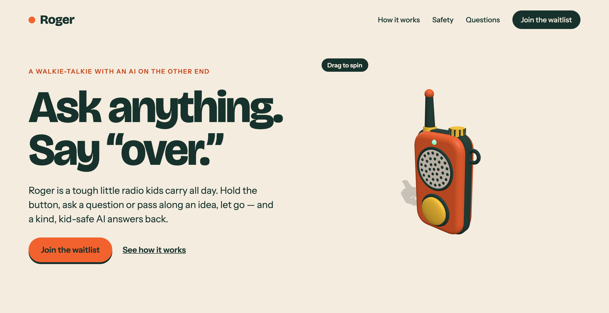
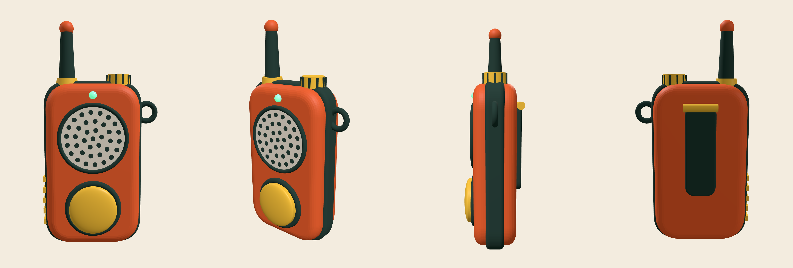
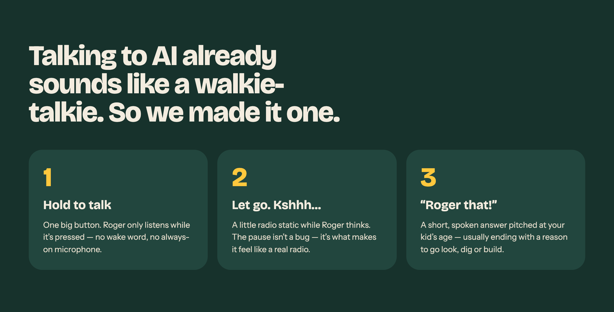
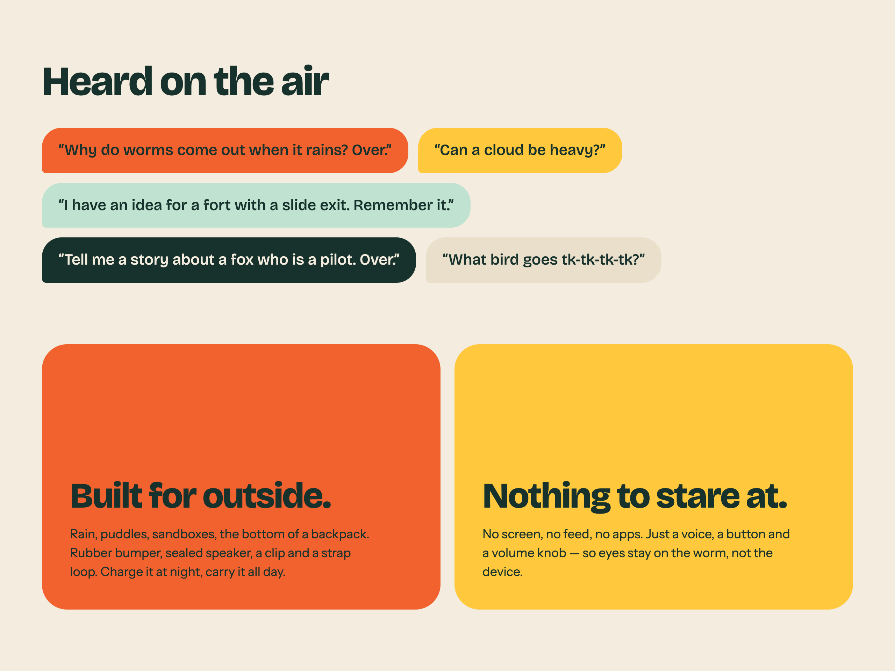

# Roger

**A walkie-talkie with an AI on the other end.** A kid holds the button, asks a question, lets go, hears a little radio static, and a kind, kid-safe voice answers. No screen, no apps, no wake word.

This repository is everything you need to build one yourself: the firmware, the server it talks to, the wire protocol between them, the wiring and printable shell, the parent-side rules and daily digest, and the design files.

[](public/index.html)



The pictures are renders of the concept, not photographs of a built radio. The page is in [`public/`](public/), the model's geometry is in [`design/model/`](design/model/), and the printable shell that follows it is in [`hardware/enclosure/`](hardware/enclosure/). More views are in [`docs/images/`](docs/images/).

```
   kid                radio                          relay                      grown-up
    |   hold + talk     |      audio (WebSocket)       |                            |
    |  ---------------> |  ------------------------->  |  rules, speech-to-text,    |
    |                   |                              |  model, guard,             |
    |   "kshhh…"        |  <----- thinking ----------  |  text-to-speech            |
    |   "Roger that!"   |  <----- reply audio -------  |                            |
    |                   |                              |  -- daily digest email --> |
```

## Status

Early. Read this table before you plan around anything here.

| Piece | State |
|---|---|
| Relay | Builds. 40-odd tests pass, including an end-to-end press over a real WebSocket. Works in mock mode with no keys. |
| Relay with real providers | **Not yet run.** The provider clients are tested against fake servers only. |
| Firmware | Compiles for both boards with pinned dependencies. **Never flashed to hardware.** |
| DIY wiring | Drawn and documented. **Never built.** |
| Enclosure | Valid solids, watertight meshes, shells do not collide. **Never printed or test-fitted.** |
| Kid-safety behaviour | A prompt, a structured reply and a deterministic guard. **Not evaluated with real children or a red team.** |
| Parent app | Wireframes. The working version is a JSON file and an email. |

So: the software side is real and testable today. The first person to flash a StickS3 will find the bugs that only hardware finds.

## Try it in ten minutes, with no hardware

You need Go 1.24 or newer.

```
cd relay
make build
./bin/roger-relay token                    # prints a token and a hash
cp devices.example.json devices.json       # paste the hash in as token_sha256
make run-mock                              # no API keys needed
```

In a second terminal:

```
cd relay
ROGER_TOKEN=rgr_... ./bin/roger-sim -out reply.wav
```

`roger-sim` plays the part of a radio. You will see the whole conversation on the wire, and `reply.wav` holds what the radio would have played. If you get `notice code=quiet_hours` instead, it is after 19:30 in the example radio's timezone and the rules are doing their job; edit `quiet_hours` in `devices.json`.

To hear real answers, add provider keys to `relay/.env` (see [`relay/README.md`](relay/README.md)).

## Build a radio

| | Tier A | Tier B |
|---|---|---|
| Hardware | M5Stack StickS3, about $22 | XIAO ESP32S3, mic, amp, speaker, battery, printed shell, about $40 |
| Effort | Flash it | Solder about 20 joints, print five parts |
| Guide | [`firmware/README.md`](firmware/README.md) | [`hardware/README.md`](hardware/README.md) |

Start with tier A.

## What is in here

| Directory | What | Licence |
|---|---|---|
| [`protocol/`](protocol/PROTOCOL.md) | The `roger.v0` wire protocol. The contract that lets any radio talk to any relay. | Apache-2.0 |
| [`relay/`](relay/README.md) | The server: rules, pipeline, safety guard, storage, digest. Go, one dependency. Includes a radio simulator. | Apache-2.0 |
| [`firmware/`](firmware/README.md) | The radio's firmware for ESP32-S3 boards. PlatformIO. | Apache-2.0 |
| [`hardware/`](hardware/README.md) | Bill of materials, wiring, and a parametric printable enclosure with STEP and STL files. | CERN-OHL-P-2.0 |
| [`parent/`](parent/README.md) | The rules schema, the digest email, and wireframes for a parent app. | Apache-2.0 (schema), CC-BY-4.0 (wireframes) |
| [`design/`](design/README.md) | Brand colours and type, the radio's sounds, the concept model, the landing page copy. | CC-BY-4.0 |
| [`docs/`](docs/) | Architecture, the safety model, privacy, cellular, roadmap. | CC-BY-4.0 |
| [`public/`](public/THIRD-PARTY.md) | The public website: a static landing page with the 3D concept model. Serve the folder as-is. | See `public/THIRD-PARTY.md` |

The name "Roger" and the logo are not covered by those licences. See [`TRADEMARK.md`](TRADEMARK.md).

## How it works

The radio is deliberately dumb. It holds a connection open, sends microphone audio while the button is down, and plays what it is sent. It has no prompt, no model key and no rules on it.

Everything that decides what a child hears lives in the relay, where it can be read, tested and changed without touching the device:

1. **Rules.** Quiet hours and daily air time, set by the parent. A refused press never reaches a model.
2. **Speech to text.** The audio is transcribed, then dropped. It is never written to disk.
3. **Reply.** A model answers as Roger, at the kid's age, through a structured reply with a topic and a flag.
4. **Guard.** A deterministic check on the words before they are spoken.
5. **Text to speech.** Streamed back to the radio.
6. **Digest.** The text of the day becomes a short email for the parent, then is deleted after a set number of days.

Because the turn is push-to-talk, the hard parts of voice products are simply absent: no wake word, no always-on microphone, no voice-activity detection, no echo cancellation. The static covers the thinking time and makes the pause feel like a radio.

More in [`docs/ARCHITECTURE.md`](docs/ARCHITECTURE.md).

## What it looks like

The concept page in [`public/`](public/) is the pitch, written for parents. Serve the folder as-is to see it with the spinning model; the whole page is also captured in [`docs/images/site-full.png`](docs/images/site-full.png).





For the grown-up side, [`parent/wireframes/`](parent/wireframes/) has the app wireframes and [`parent/digest/`](parent/digest/) has a sample of the daily email.

## Before a child uses one

Read [`docs/SAFETY.md`](docs/SAFETY.md) and [`docs/PRIVACY.md`](docs/PRIVACY.md). The short version:

- This is an AI. It can say wrong things, and the safety layers here are a first version that has not been independently tested.
- If you run a relay, a child's voice passes through the speech and model providers you chose, under the terms you agreed to. Check that those terms allow a product used by children.
- An adult should use the radio for a while first, and should read the digest.

## Contributing

See [`CONTRIBUTING.md`](CONTRIBUTING.md). The most useful things right now are a bring-up report from real hardware and a test print of the shell. The plan is in [`docs/ROADMAP.md`](docs/ROADMAP.md).

## Licence

Code is Apache-2.0, hardware is CERN-OHL-P-2.0, design and documentation are CC-BY-4.0. Full texts are in [`LICENSES/`](LICENSES/), and the table above says which applies where.
