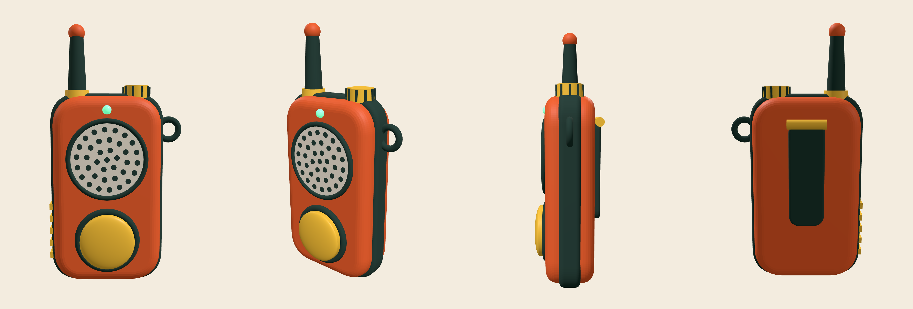

# Design

What Roger looks, sounds and reads like. Use these when you build anything with the Roger name on it; see [`TRADEMARK.md`](../TRADEMARK.md) for where the name itself can go.

| | |
|---|---|
| [`brand/`](brand/) | Colours and type as `tokens.json` and `tokens.css`, and the logo |
| [`sounds/`](sounds/) | The radio's built-in sounds as WAV files, and the script that makes them |
| [`model/`](model/) | The concept model's geometry: proportions and colours for the radio itself |
| [`copy.md`](copy.md) | The words on the concept page |

The concept page with the spinning 3D radio is published here: <https://claude.ai/code/artifact/f5dd78a3-7912-4636-b2aa-0863cf2492c7>. A copy that any static host can serve is in [`public/`](../public/), outside the licences in this folder because its export bundles viewer code that is not ours to relicense. Its words are in `copy.md` and its model is in `model/`. Rendered views of the model are in [`docs/images/`](../docs/images/).

## The idea in one line

Talking to an AI already sounds like a walkie-talkie: you say something, you wait, it answers. So make it one.

## Colour

| Name | Hex | Where |
|---|---|---|
| Ink | `#17322C` | Text, dark sections |
| Paper | `#F3ECDF` | Backgrounds |
| Orange | `#F2622E` | The radio's shell, the logo dot, primary buttons |
| Ember | `#C7461A` | Small orange text on paper |
| Rubber | `#1F3D36` | Bumper, antenna, grille |
| Cream | `#F4EBDD` | Speaker plate, text on ink |
| Yellow | `#FFC83D` | The talk button and knob |
| Mint | `#9FF0C4` | The status light |

The radio is orange with a yellow button. A kid should be able to find it in long grass.

## Type

- **Bricolage Grotesque**, ExtraBold, tight tracking, for headlines and the wordmark.
- **Instrument Sans** for everything else.

Both are open-source fonts available from Google Fonts.

## Voice

Roger speaks in short sentences and a little radio slang: "Roger that", "Over", "off the air". It is used lightly, as flavour. The writing for grown-ups is plain and specific about what the product does and does not do. Avoid "magical", "smart" and anything that makes the AI sound like a person.

## Interaction map

The radio has one button, one light and a speaker. This is the whole interface.

| Moment | Light (StickS3 dot) | Sound | File |
|---|---|---|---|
| Ready | Mint | Silent | |
| Not connected | Grey | Silent | |
| Button down | Orange | Silent. The kid is talking. | |
| Button up | Yellow | One short high beep | `roger_beep.wav` |
| Roger is thinking | Yellow | Radio static | `static.wav` |
| Roger is speaking | Cream | Roger's voice | |
| Roger has finished | Mint | A flick of static and a lower beep | `over_beep.wav` |
| Did not catch that | Mint | Two short pips | `not_heard.wav` |
| Not now: offline, quiet hours, out of air time | Mint, or grey if offline | Two falling notes | `off_air.wav` |
| Something broke | Red, briefly | A low buzz | `problem.wav` |

The DIY build has one LED instead of a coloured dot: off when ready, on while listening, blinking fast while thinking, mostly on while speaking, and a short flash every two seconds when not connected.

`turn_demo.wav` strings a whole turn together, with silence where Roger's voice would be.

Rules behind the table:

- **Every press gets an answer of some kind**, even if it is only a tone. Silence after a press reads as broken.
- **Refusals stay in the story.** Quiet hours is "Roger's off the air for the night", never an error.
- **Sounds are synthesised on the device.** The WAV files here are for listening; `sounds/generate.py` mirrors `firmware/src/sounds.cpp`. Change both together.
- **None of these sounds has been tuned on a real speaker yet.** Levels and lengths are first guesses.

## The object

From the concept model, in millimetres:

| | |
|---|---|
| Body | 68 × 118 × 30, corners rounded at 12 |
| Speaker | 47 across, centred 20 above the middle |
| Talk button | 34 across, centred 31 below the middle |
| Antenna | 36 tall, top left. Decorative for now. |
| Volume knob | 16 across, top right |
| Also | A status light above the speaker, a strap lug, grip ribs, a belt clip, a rubber band around the middle |

The printable shell in [`hardware/enclosure`](../hardware/enclosure) follows these, with a few practical changes listed in the hardware README.
