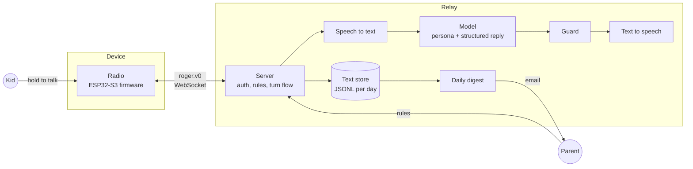

# Architecture

## The shape

Three pieces, one contract between the first two:

| Piece | Lives in | Knows about |
|---|---|---|
| Radio | `firmware/` | A button, a microphone, a speaker, Wi-Fi, the protocol. Nothing else. |
| Protocol | `protocol/` | Messages and rules. No opinions about models or hardware. |
| Relay | `relay/` | Everything that decides what a child hears. |

## Why thin device, fat relay

- **Safety is changeable.** The prompt, the guard and the rules can be fixed in minutes without reflashing anything a child is holding.
- **Secrets stay off the device.** A radio holds one revocable token. Model keys never leave the server. A lost radio is a token to delete.
- **Open hardware is safe to open.** Anyone can build a radio and nothing about a radio lets it bypass a relay's rules.
- **Hardware stays cheap.** The device needs no more than an ESP32-S3.

The cost is that Roger needs a connection to answer. There is no offline mode and none is planned.

## Why push-to-talk

A held button is the whole turn-taking system. It removes:

- the wake word, and with it the always-on microphone;
- voice-activity detection and its mistakes with children's speech;
- echo cancellation, because the radio never listens while it speaks;
- barge-in logic, because pressing again is the interruption.

It also gives the product its feel. The pause while Roger thinks is expected on a radio, and static makes it sound intentional.

## Why three stages and not one speech model

Speech-to-speech models are faster, but Roger goes through text on purpose:

- **There is a text checkpoint in each direction.** What the kid said and what Roger will say both exist as text the relay can inspect before any audio reaches a child.
- **The parent's digest needs text anyway.**
- **Each stage is replaceable**, including by a model running on your own machine.

The static covers the added latency. If the pause turns out to be too long in real use, this is the decision to revisit.

## One press, step by step

| Step | Where | What happens |
|---|---|---|
| 1 | Radio | Button down. Send `ptt.down`, then start the microphone. |
| 2 | Relay | Check quiet hours and air time. If refused, send a notice and drop this press's audio. |
| 3 | Radio | Stream audio until the button comes up. Stop the microphone, then send `ptt.up`. Play a short beep and start the static. |
| 4 | Relay | Transcribe. Zero the audio buffer. |
| 5 | Relay | Build the prompt for this kid: age band, family rules, things they asked Roger to remember, the last few exchanges. |
| 6 | Relay | Model call, forced through a tool so the reply is always `{say, topic, flag, remember}`. |
| 7 | Relay | Guard the words. A blocked reply is replaced by a fixed line and flagged for the parent. |
| 8 | Relay | Text to speech, streamed to the radio about 600 ms ahead of real time. |
| 9 | Radio | Stop the static, buffer 200 ms, play. On `reply.end`, play the "over" tone. |
| 10 | Relay | Append the text of the turn to today's file. |

## Latency

Nothing here has been measured on real providers yet. These are the budget lines to measure against once it has:

| Stage | Expectation |
|---|---|
| Upload | None extra. Audio streams while the kid talks. |
| Speech to text | Runs on the whole press after release. Likely the largest fixed cost. |
| Model | A small, fast model with a reply of well under 100 words. |
| Text to speech | Time to first audio matters, not total time. The relay forwards audio as it arrives. |

The relay records `latency_ms` (release to first audio) for every turn, in the log and in the day file, so the real numbers are one `grep` away.

The obvious improvements, in order of likely payoff: streaming transcription during the press, starting text to speech on the first sentence of a streamed reply, and a persistent provider connection.

## State and storage

The relay has no database. Each radio has a folder of small text files (see [`relay/README.md`](../relay/README.md)). Conversation context is held in memory, limited to the last six exchanges, and dropped after 20 minutes of quiet.

That is enough for a household and wrong for a service. A hosted relay would need a real datastore, accounts and a pairing flow; none of that is here.

## Trust boundaries

| Boundary | What crosses it | Protection |
|---|---|---|
| Radio to relay | A child's voice, Roger's voice | TLS with certificate verification for any relay off the home network. Bearer token per radio. |
| Relay to speech provider | Audio of each press; text of each reply | The provider's terms and retention. See [`PRIVACY.md`](PRIVACY.md). |
| Relay to model provider | Text of what was heard, a first name, an age | Same. |
| Relay to parent | The daily digest | Email, so only as private as the parent's inbox. |
| Relay disk | Text of each turn | File permissions; retention limits; `erase`. Not encrypted at rest. |
