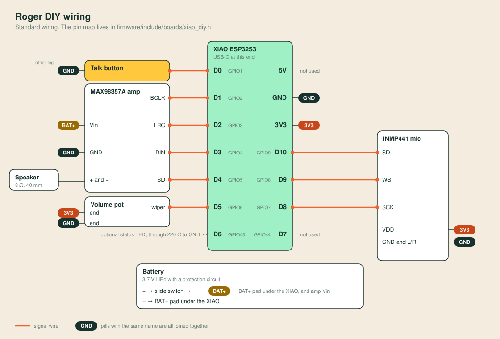
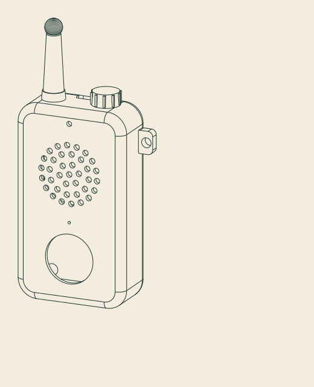

# Hardware

Two ways to build a Roger. Both run the same firmware and talk to the same relay.

| | Tier A: StickS3 | Tier B: DIY |
|---|---|---|
| What it is | An off-the-shelf M5Stack StickS3 | A XIAO ESP32S3, a mic, an amp and a speaker in a printed shell |
| Soldering | None | About 20 joints |
| Printing | None | Five parts |
| Looks like Roger | No. It is a small plastic stick. | Yes |
| Good for | Proving the idea this afternoon | A radio a kid can carry |
| Parts cost | About $22 | About $40, plus filament (estimate) |

Start with tier A. Everything that matters about the product (does a kid like it, are the answers good, does the pause feel like a radio) can be learned on it.

> **Status: unbuilt.** The firmware compiles for both boards. Nobody has yet flashed it onto hardware, wired the DIY circuit, or printed the shell. Treat the wiring and the enclosure as a careful first draft, and please open an issue with what you find.

## Bill of materials

See [`BOM.csv`](BOM.csv). Prices are rough estimates in US dollars, except the StickS3, which was listed at $21.50 in January 2026. Check current prices before ordering.

## Tier A: StickS3

1. Flash the `m5sticks3` firmware (see [`firmware/README.md`](../firmware/README.md)).
2. Hold the big front button and talk. Let go to hear the answer.
3. The side button cycles the volume through four levels.

The screen shows only a small coloured dot: mint when ready, orange while listening, yellow while thinking, cream while speaking.

## Tier B: DIY

### Wiring



| From | To | Notes |
|---|---|---|
| Talk button, one leg | XIAO D0 | |
| Talk button, other leg | GND | |
| Amp BCLK | XIAO D1 | |
| Amp LRC | XIAO D2 | |
| Amp DIN | XIAO D3 | |
| Amp SD | XIAO D4 | The firmware switches the amp off when Roger is silent |
| Amp Vin | BAT+ (after the switch) | The amp draws more than the XIAO's 3.3 V regulator should supply |
| Amp GND | GND | |
| Amp + and − | Speaker | |
| Pot wiper | XIAO D5 | |
| Pot ends | 3V3 and GND | If the knob works backwards, swap these two |
| Mic SCK | XIAO D8 | |
| Mic WS | XIAO D9 | |
| Mic SD | XIAO D10 | |
| Mic VDD | 3V3 | |
| Mic GND and L/R | GND | |
| Battery + | Slide switch, then the BAT+ pad under the XIAO | |
| Battery − | BAT− pad under the XIAO | |

The pin numbers live in one place, [`firmware/include/boards/xiao_diy.h`](../firmware/include/boards/xiao_diy.h). The diagram is drawn by [`wiring/make_wiring.py`](wiring/make_wiring.py). Change them together.

**Battery safety.** Use a cell with a built-in protection circuit. Check the polarity of the leads with a meter before connecting; LiPo connectors are not standardised and a reversed cell will destroy the board. Do not leave a home-built battery device charging unattended, and do not hand one to a child until an adult has used it for a while.

### Optional: the hard microphone switch

The landing page says the microphone is physically off until the button is held. With the standard wiring above that is true only in software: the firmware starts and stops the microphone, and the relay refuses audio that arrives outside a press, but the mic stays powered.

To make it true in hardware, let the button carry the microphone's power:

| From | To |
|---|---|
| Talk button, common leg | 3V3 |
| Talk button, normally-open leg | Mic VDD **and** XIAO D0 |
| 10k resistor | Between D0 and GND |

Then set `PTT_ACTIVE_HIGH` to `1` in `xiao_diy.h`. Pressing the button now powers the mic and signals the press with the same contact. Releasing it cuts the mic's supply.

Two things to know before choosing this:

- The microphone needs a moment to wake up each time it is powered, so the start of every press is lost. The firmware allows 260 ms (`MIC_WARMUP_MS`, an estimate to tune on real hardware) and sends silence for that stretch rather than noise. Kids will need to learn "press, then talk".
- **This wiring is untested.** In particular, check with a meter that the mic's supply pin really falls to 0 V on release. An unpowered chip can be partly powered through its signal pins if the clock lines idle high, which would defeat the purpose. If you see that, the fix is in firmware (drive the I2S pins low when idle) and we would like to hear about it.

The production design should do this properly, with a load switch on the microphone rail. See [`docs/ROADMAP.md`](../docs/ROADMAP.md).

### Enclosure



Five printed parts, generated from one parametric script:

| Part | Material | Notes |
|---|---|---|
| `front_shell` | PLA or PETG | Print face down. Carries the grille, the button hole and the screw bosses. |
| `back_shell` | PLA or PETG | Print back down. Has the alignment lip, USB-C opening and strap lug. |
| `antenna` | PLA or PETG | Decorative. Glue the peg into the socket on top. |
| `volume_knob` | PLA or PETG | Push fit on a 6 mm knurled shaft. |
| `bumper_band` | TPU | Optional soft band around the seam. |

Ready-made files are in [`enclosure/stl`](enclosure/stl) and [`enclosure/step`](enclosure/step). To change a dimension, edit the parameters at the top of [`enclosure/enclosure.py`](enclosure/enclosure.py) and run it:

```
pip install cadquery
python hardware/enclosure/enclosure.py
```

The outside is 68 × 118 × 32 mm, following the concept model in `design/model` (which is 30 mm deep; the extra 2 mm gives the arcade button room). What has been checked: every part is a single valid solid, the STL meshes are watertight, and the two shells do not intersect when closed. What has not been checked is everything that needs a printer and the real parts: the fit of the button, speaker, pot and USB-C plug, and whether there is room for the wiring. Print the front shell first and test-fit before printing the rest.

Inside, the speaker sits in the ring behind the grille, the XIAO lies against the back with its USB-C at the top opening, and the battery, amp and mic are held with double-sided foam tape. The microphone goes behind the small hole between the grille and the button.

### Not yet designed

- Sealing against rain and sand. The concept is "built for outside"; this shell is not.
- A belt clip.
- Any drop testing.

## Licence

Everything in this directory is under CERN-OHL-P v2. See [`../LICENSES`](../LICENSES).
