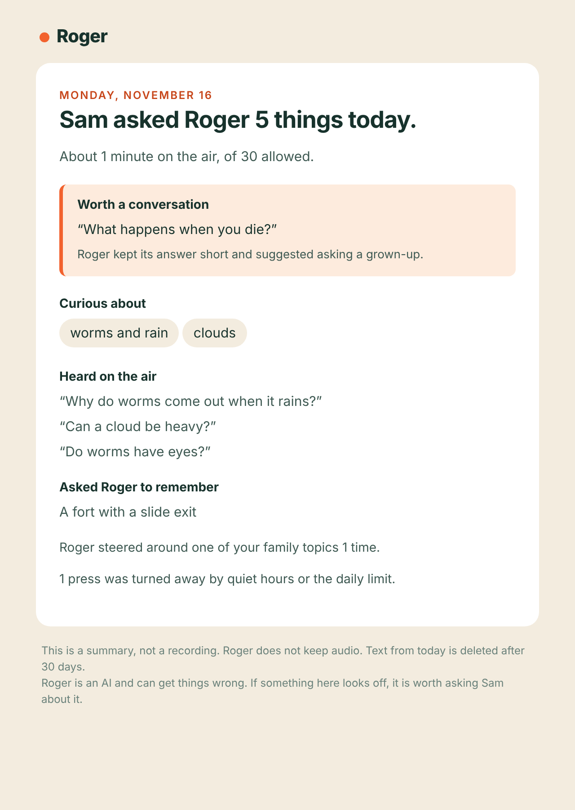
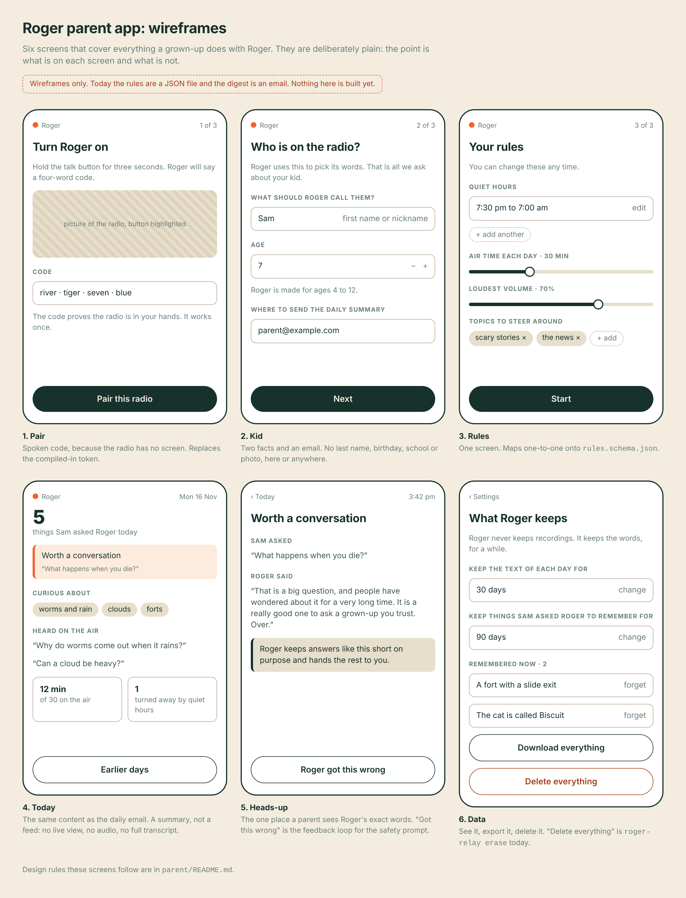

# The parent side

What a grown-up sets and what a grown-up sees.

| | | State |
|---|---|---|
| [`rules.schema.json`](rules.schema.json) | Every rule a parent can set, as a JSON Schema | Enforced by the relay today |
| [`rules.example.json`](rules.example.json) | A filled-in example | Loaded by the relay's tests |
| [`digest/`](digest/) | A sample of the daily email | Sent by the relay today, if SMTP is configured |
| [`wireframes/`](wireframes/) | Six screens for a parent app | Not built |

## Rules

| Rule | Default | What it does |
|---|---|---|
| `quiet_hours` | 19:30 to 07:00 | Presses are refused. Roger says it is off the air, once, then just plays a tone. |
| `daily_airtime_minutes` | 30 | Total audio per day, both directions. When it runs out Roger says so and suggests building something. |
| `volume_cap` | 70 | The radio never plays louder than this percentage. |
| `steer_around` | none | Topics Roger redirects away from. The digest counts how often, without quoting. |
| `transcript_retention_days` | 30 | Days the text of each press is kept. |
| `remembered_retention_days` | 90 | Days Roger keeps things the kid asked it to remember. |
| `digest` | on, 19:00, with questions | The daily email. |

Rules live in the `rules` block of each radio in the relay's `devices.json`. A radio with no rules block gets the defaults above. A partial block can never mean "keep forever" or "no volume cap": missing retention and volume values fall back to the defaults.

## The digest

The relay renders this from the day's text and emails it at `send_at`. The template is [`relay/internal/digest/template.html`](../relay/internal/digest/template.html); `make digest-sample` in `relay/` regenerates the sample here.

What it shows, in order:

1. **How many things were asked**, and minutes on the air.
2. **Worth a conversation.** Any question Roger flagged for a grown-up, quoted. Always shown.
3. **Curious about.** Topics, deduplicated.
4. **Heard on the air.** Up to five ordinary questions, quoted. Can be turned off.
5. **Asked Roger to remember.** Notes from today.
6. Counts of presses that were steered away or refused.

What it leaves out on purpose: Roger's answers (apart from the note under a flagged question), anything from a topic the family asked Roger to steer around, timestamps for each press, and audio.

## Wireframes

Open [`wireframes/index.html`](wireframes/index.html) in a browser for the live version.

## Design rules for anything a parent sees

1. **Summary, not surveillance.** No live view, no playback, no full transcript by default. A parent learns what their kid is curious about, and is told when something needs them.
2. **Ask for almost nothing.** A nickname, an age, an email.
3. **One screen of rules.** If a rule needs explaining it is the wrong rule.
4. **Say what is kept, in days.** Every retention setting is a number a parent can change.
5. **Deleting is one action** and needs no reason.
6. **Never imply the AI is always right.** Every digest says so.
